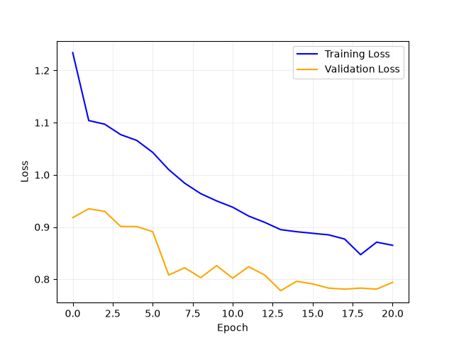
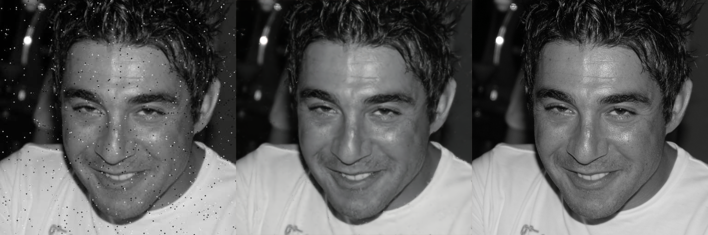
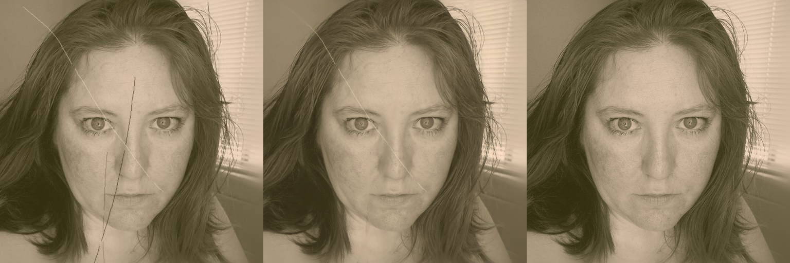

## Попытка 4 — комбинированная функция ошибки SSIM + L1

> **Главное:** обучение остановилось на 20-й эпохе из-за переобучения, сохранена лучшая модель с 13-й эпохи. Средняя ошибка — **0.8025**. Модель научилась убирать полосы, чёрно-белые точки и шум, но контраст пока не восстанавливает.

### Параметры

| Параметр | Значение |
|---|---|
| Оптимизатор | Adam, `lr = 0.0001` |
| L2-регуляризатор | `0.001` |
| Функция ошибки | комбинированная **SSIM + L1Loss** |
| Эпох (максимум) | 80 |
| Размер батча | 8 |
| Размер фото | 512×512 |
| Датасет | 12 эффектов |
| Обучение / Валидация / Тестирование | 15 000 / 1 000 / 1 000 фото |
| Метрика | средняя ошибка по SSIM и L1Loss |

### Что изменилось по сравнению с попыткой 3

####Вставить####

### Результаты

- Обучение завершилось на **20-й эпохе** (переобучение).
- Лучшая модель - **13-я эпоха**, именно она сохранена.
- Средняя ошибка: **0.8025**.

#### График обучения



*Training loss (синяя) падает почти всё время, validation loss (оранжевая) выходит на плато около 13-й эпохи — дальше растёт разрыв между кривыми, это признак переобучения.*

#### Примеры работы модели

Слева направо: **с дефектами → результат модели → оригинал**.

| Точки и шум | Шум и полосы | Царапины и волосы |
|:---:|:---:|:---:|
|  |  |  |

Модель начала убирать полосы, чёрно-белые точки и шум. Контраста пока не хватает.

### Заметка про функцию ошибки

Для SSIM использована самописная функция на основе `conv2d` с гауссовым окном в качестве ядра. В итоговой формуле вместо `0.5` случайно был написан коэффициент `5`:

```python
# как задумывалось
return 0.5 * F.l1_loss(predict, target) + 0.5 * (1 - MSSIM) / 2
# как было в эксперименте
return 0.5 * F.l1_loss(predict, target) + 5 * (1 - MSSIM) / 2
```

Из-за этого вес SSIM оказался намного больше веса L1, и это дало очень сильный эффект на качество.

### Вывод

- Влияние L1Loss нужно сделать минимальным (вес SSIM остаётся доминирующим).
- Попробовать **Perceptual Loss**.
- Изучить метрику **PSNR**.